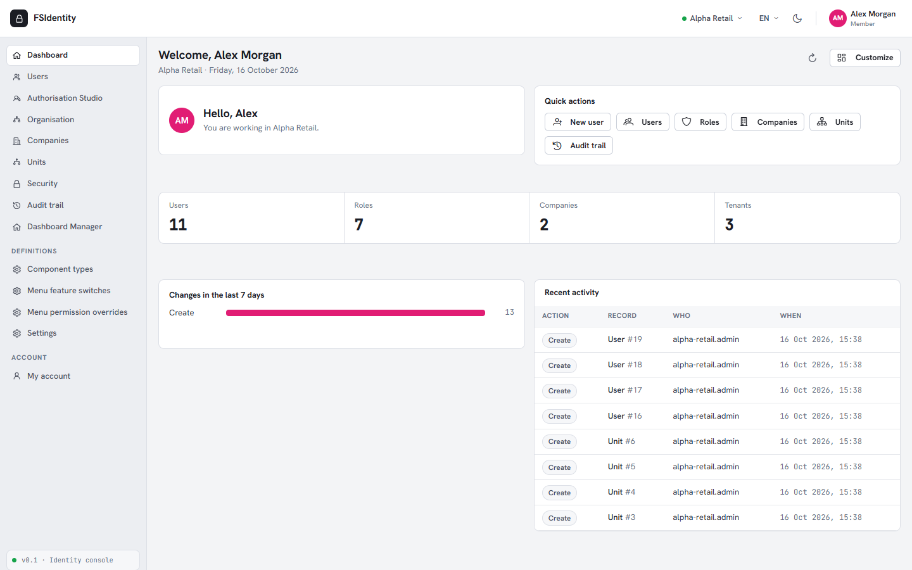
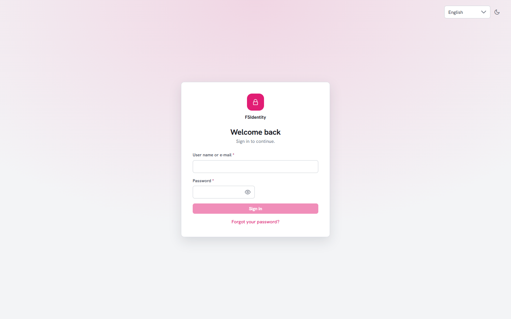
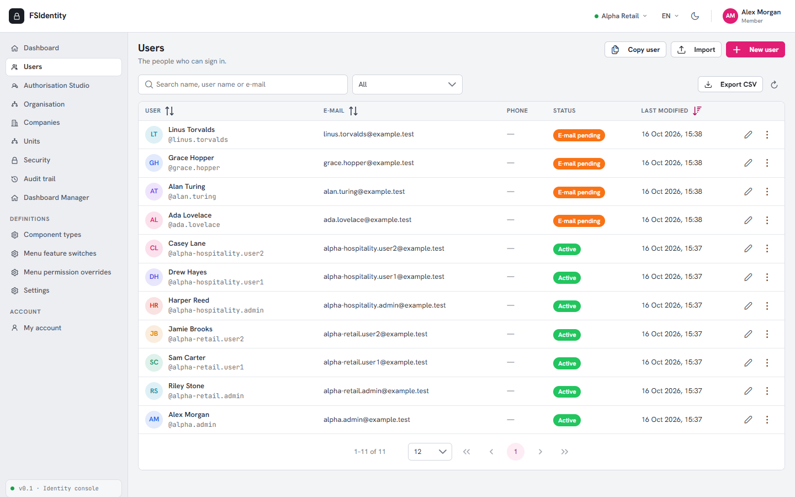
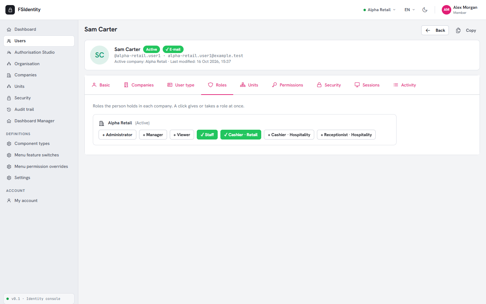
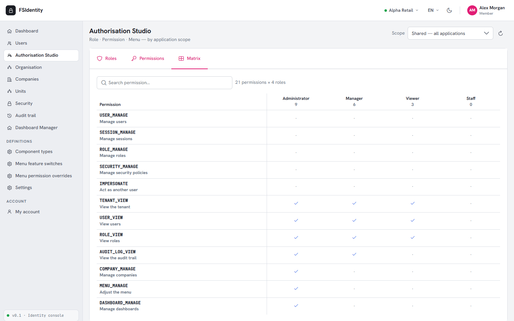
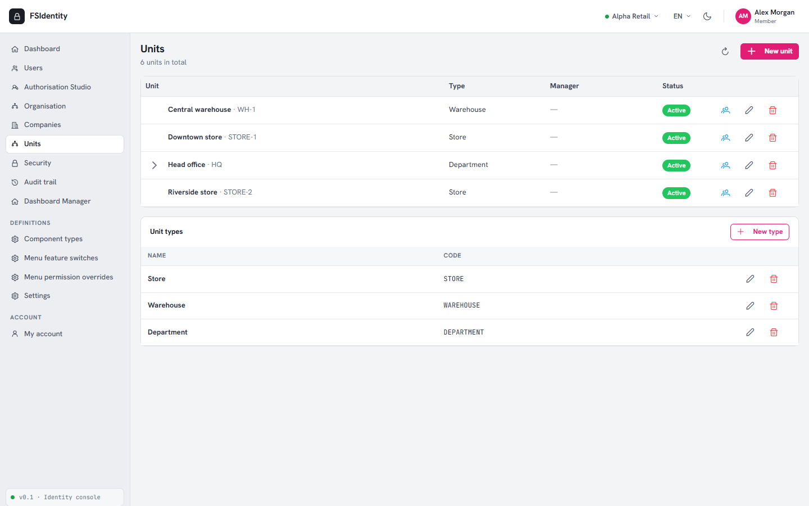
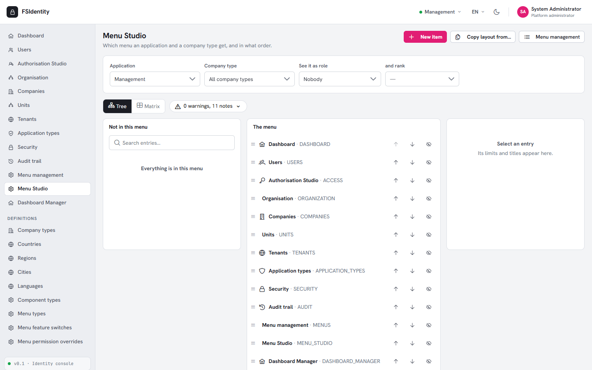
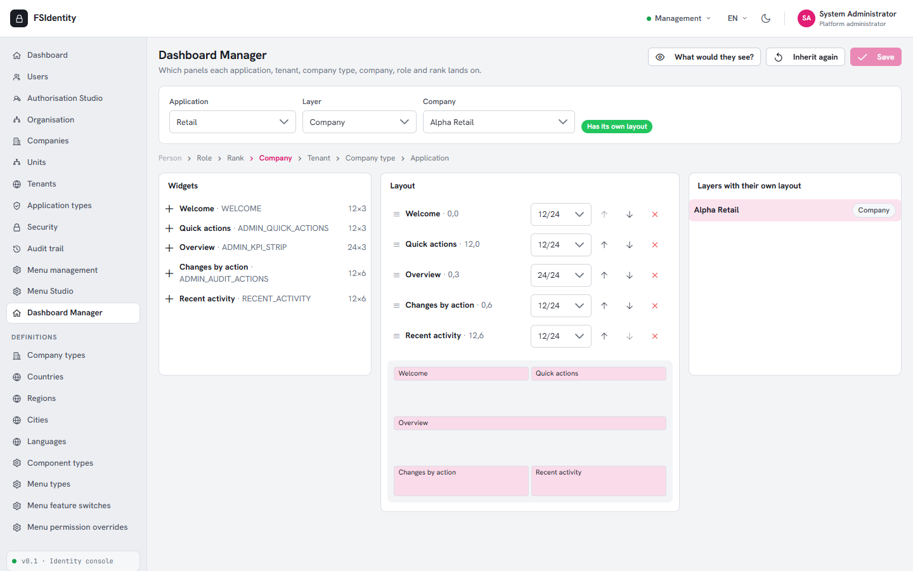
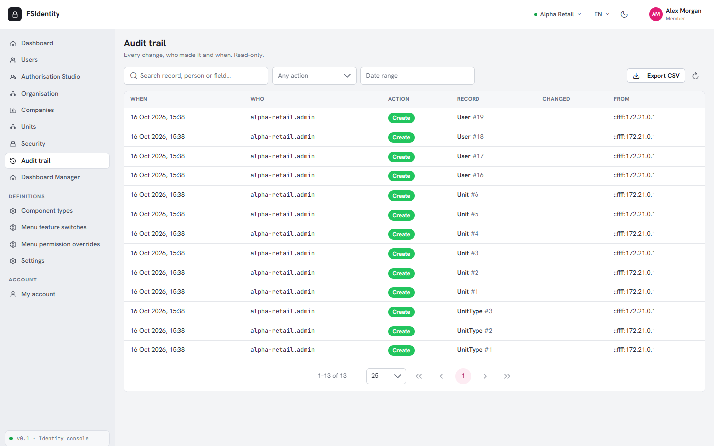
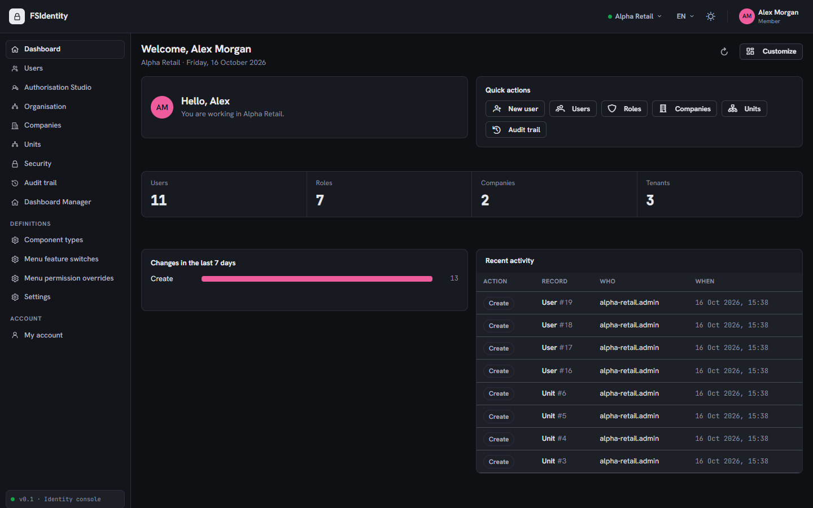

# multi-identity-app

**Identity, organisation and access control, built once and implemented in many stacks.**

Almost every business application starts by rebuilding the same things: sign-in, users, roles and permissions, tenants and companies, an audit trail, a menu and a dashboard per person. `multi-identity-app` is that foundation as a ready-made, tested product. It defines **one API contract**, one database schema and one JWT format, and implements them independently in several languages, so you can pick the stack you like, start from a working system, and swap backends or frontends without touching the rest.

[](LICENSE)




**Who it is for:** teams building a multi-tenant business application (SaaS, internal tools, vertical software) who want sign-in, users, permissions, organisation, audit and a working admin console on day one instead of month three.

## Quick start

Needs only Git and Docker.

```bash
git clone https://github.com/ferhatbas/multi-identity-app.git && cd multi-identity-app/devops
cp .env.example .env            # then set MSSQL_SA_PASSWORD and JWT_KEY (see Installation)
docker compose up -d --build && docker compose run --rm --entrypoint "dotnet FSIdentity.Api.dll --seed-demo" api-setup
```

Open <http://localhost:3041> and sign in as `admin` (demo password below). Call the API from code: see [`examples/`](examples/).

---

## What you get

| Area | What it does |
| --- | --- |
| **Authentication** | Sign-in with JWT access tokens and rotating refresh tokens, two-factor (TOTP) with recovery codes, password reset by e-mail, account lock-out, "view as user" (impersonation) with a recorded reason |
| **Multi-tenancy** | Tenants own companies and people; every record is scoped to its tenant and company, with soft delete and audit fields on every entity |
| **People and access** | Users with several company memberships, ranks (Reader, Standard, Company admin, Tenant admin, Platform admin), roles that belong to an application, per-user grants and denials, effective-permission view |
| **Organisation** | Companies, company types, units in a tree, tenants, an organisation hierarchy view |
| **Applications** | Several applications behind one sign-in; which company types may use which application; roles and menus scoped per application |
| **Security** | Password, lock-out, session and two-factor policies per tenant (a tenant can only tighten the platform's rules); separation-of-duties rules |
| **Audit trail** | Append-only record of every change: who, when, from where, before and after |
| **Menus and dashboards** | A menu and a dashboard resolved per person (user, role, rank, company, tenant, company type, application), with a Menu Studio and a Dashboard Manager to arrange them |
| **Web console** | React + TypeScript + PrimeReact: lists, tabbed editors, wizards, CSV import and export, light and dark theme |

## Screenshots

Taken from the demo data described below (English, light and dark themes).

| | |
| --- | --- |
| <br>**Sign-in** | <br>**Dashboard**, arranged per company, role or person |
| <br>**Users**: search, filter, import, copy, view as user | <br>**User editor**: companies, rank, roles, units, permissions, security, sessions |
| <br>**Authorisation Studio**: roles, permissions and the role-by-permission matrix | <br>**Units**: a tree per company, with unit types |
| <br>**Menu Studio**: arrange the menu per application and company type, see it as a role | <br>**Dashboard Manager**: layers from application down to a person |
| <br>**Audit trail**: every change, with who and when | <br>**Dark theme** |

## Repository layout

```
multi-identity-app/
├── backends/
│   ├── dotnet/            .NET 10 implementation (ASP.NET Core, EF Core, SQL Server)
│   ├── py/                Python implementation (planned)
│   └── rs/                Rust implementation (planned)
├── frontends/
│   └── web-react-vite/    Web console (React 19, Vite, PrimeReact)
├── contracts/             The shared API contract and the OpenAPI snapshot
└── devops/                docker-compose for the database, API and web console
```

| Part | Status |
| --- | --- |
| .NET backend | Complete; 600+ automated tests |
| Web console (React) | Complete; works against any backend that follows the contract |
| Python backend (FastAPI) | Planned |
| Rust backend | Planned |
| More frontends | Planned |

---

## Installation

The fastest way to run everything on **Windows, macOS or Linux** is Docker. You need nothing else installed: no .NET SDK, no Node, no SQL Server.

### Requirements

- [Git](https://git-scm.com/)
- [Docker](https://docs.docker.com/get-docker/) with Compose v2 (Docker Desktop on Windows and macOS, Docker Engine on Linux), about 4 GB of free memory for SQL Server

### 1. Get the code

```bash
git clone https://github.com/ferhatbas/multi-identity-app.git
cd multi-identity-app/devops
```

### 2. Create your settings

```bash
cp .env.example .env          # Windows PowerShell: Copy-Item .env.example .env
```

Open `devops/.env` and fill in the two secrets. Both are yours to invent; nothing is sent anywhere.

| Setting | What it is | Rules |
| --- | --- | --- |
| `MSSQL_SA_PASSWORD` | Password of the local SQL Server | 8+ characters with upper case, lower case, a digit and a symbol |
| `JWT_KEY` | Key that signs the access tokens | 32+ random characters |

Generate them if you like:

```bash
# macOS / Linux
openssl rand -base64 36                      # JWT_KEY
echo "Aa1!$(openssl rand -hex 12)"           # MSSQL_SA_PASSWORD
```

```powershell
# Windows PowerShell
-join ((48..57) + (65..90) + (97..122) | Get-Random -Count 40 | ForEach-Object { [char]$_ })   # JWT_KEY
"Aa1!" + (-join ((48..57) + (65..90) + (97..122) | Get-Random -Count 16 | ForEach-Object { [char]$_ }))   # MSSQL_SA_PASSWORD
```

The other settings have working defaults (ports `1435`, `5240`, `3041`; database `FSIDENTITY`). Never commit `.env`; it is git-ignored.

### 3. Start everything

```bash
docker compose up -d --build
```

This builds the images, starts SQL Server, creates the database, applies the migrations, loads the reference data (languages, countries, Turkey's regions and provinces, applications and modules) and starts the API and the web console. The first run takes a few minutes.

### 4. Load the demo data

```bash
docker compose run --rm --entrypoint "dotnet FSIdentity.Api.dll --seed-demo" api-setup
```

This creates a management tenant, two customer tenants with two companies each, four applications, and a set of ready-to-use accounts (below). It only runs on an empty database.

### 5. Open it

| What | URL |
| --- | --- |
| Web console | <http://localhost:3041> |
| API | <http://localhost:5240> (health check: `GET /api/Health`) |

Sign in with one of the demo accounts below.

---

## Demo accounts

Everybody's password is **`Demo@12345`**. These accounts exist for local demos only; never use the demo data for real people.

| User name | Who | What to try |
| --- | --- | --- |
| `admin` | Platform administrator (management tenant) | Everything: tenants, application types, definitions, menus, Menu Studio, Dashboard Manager, the System page |
| `alpha.admin` | Tenant administrator of tenant **ALPHA** | Both ALPHA companies; users, roles, units, security, audit trail; switch company in the top bar |
| `beta.admin` | Tenant administrator of tenant **BETA** | Both BETA companies |
| `alpha-retail.admin` | Company administrator of ALPHA-RETAIL | Users and units of one company |
| `alpha-hospitality.admin` | Company administrator of ALPHA-HOSPITALITY | Same, in the Hospitality application |
| `beta-logistics.admin`, `beta-education.admin` | Company administrators of the BETA companies | |
| `alpha-retail.user1`, `alpha-retail.user2` | Ordinary users | See how a menu and a dashboard shrink to what a person may do |
| `alpha-hospitality.user1`, `alpha-hospitality.user2`, `beta-logistics.user1`, `beta-logistics.user2`, `beta-education.user1`, `beta-education.user2` | Ordinary users of the other companies | |

A good first tour: sign in as `admin`, open **Users**, open a person, and look at the **Roles**, **Permissions** and **Sessions** tabs; then sign in as `alpha.admin` and compare what the menu shows. In **Users**, the row menu has **View as user**.

Change the demo (names, companies, applications, password) with a JSON file; see [`backends/dotnet/README.md`](backends/dotnet/README.md).

### Starting a real system instead

For a first real administrator, load the minimum instead of the demo (also only on an empty database):

```bash
docker compose run --rm --entrypoint "dotnet FSIdentity.Api.dll --seed-identity" api-setup
```

It creates one tenant, one company and one administrator. Without an `IdentitySeed__AdminPassword` setting a password is generated and printed once, and the administrator must change it at the first sign-in.

---

## Everyday commands

Run these from `devops/`.

| Goal | Command |
| --- | --- |
| Stop (keep the data) | `docker compose down` |
| Start again | `docker compose up -d` |
| Reset everything, data included | `docker compose down -v` (then repeat steps 3 and 4) |
| See the logs | `docker compose logs -f api` |
| Rebuild after changing the code | `docker compose up -d --build api web` |
| Web console with hot reload while you work on it | `docker compose --profile dev up -d web-dev`, then open <http://localhost:3040> |

## Working on the code without Docker for the app

Keep Docker for the database only and run the pieces yourself.

**Requirements:** .NET 10 SDK, Node.js 22+.

```bash
# database
cd devops && docker compose up -d mssql mssql-init

# API (keep the connection string and JWT key in user-secrets, never in git)
cd ../backends/dotnet/src/FSIdentity.Api
dotnet user-secrets set "ConnectionStrings:Default" "Server=localhost,1435;Database=FSIDENTITY;User Id=sa;Password=<MSSQL_SA_PASSWORD>;TrustServerCertificate=True"
dotnet user-secrets set "Jwt:Key" "<at least 32 random characters>"
dotnet run -- --migrate
dotnet run -- --seed
dotnet run -- --seed-demo
dotnet run                       # http://localhost:5231

# web console (Vite proxies /api to the API)
cd ../../../../frontends/web-react-vite
npm install
npm run dev                      # http://localhost:3040
```

Tests:

```bash
dotnet test backends/dotnet/tests/FSIdentity.Tests     # no database needed
npm --prefix frontends/web-react-vite run typecheck
npm --prefix frontends/web-react-vite run i18n          # checks the translation files against the code
```

Details for each part: [`backends/dotnet/README.md`](backends/dotnet/README.md), [`frontends/web-react-vite/README.md`](frontends/web-react-vite/README.md), [`devops/README.md`](devops/README.md).

---

## Troubleshooting

| Symptom | Cause and fix |
| --- | --- |
| `docker compose` says `Set MSSQL_SA_PASSWORD` or `Set JWT_KEY` | `devops/.env` is missing or a value is empty; see step 2 |
| `mssql` never becomes healthy | The password is too weak for SQL Server, or Docker has less than about 4 GB of memory |
| `--seed-demo` refuses to run | The database is not empty. Reset with `docker compose down -v`, repeat steps 3 and 4 |
| A port is already in use | Change `MSSQL_PORT`, `API_PORT` or `WEB_PORT` in `devops/.env` |
| The web console cannot reach the API | Check `docker compose ps` and `docker compose logs -f api` |

---

## The contract

Every backend must behave identically from a client's point of view, so a client written once works against all of them.

- **Envelope:** every response has `code`, `message`, `data`, `types`, `errors`, `timestamp`, `traceId`
- **Pagination:** `pageNumber`, `pageSize`, `totalPages`, `totalRecords`, `data`
- **JWT:** HS256 with a shared key; claims such as `UserId`, `TenantId`, `ActiveCompanyId`, `ActiveApplicationTypeId`, `IsSuperAdmin`, `sid`. A token issued by one backend is accepted by the others
- **JSON** in `camelCase`; tenant and company scoping, soft delete and audit fields on every entity
- **Errors** carry a stable `code` clients can switch on

The full contract is [`contracts/api-envelope.md`](contracts/api-envelope.md); the generated OpenAPI snapshot is [`contracts/openapi.json`](contracts/openapi.json) and a test fails if the API drifts from it.

## Roadmap

- Python backend (FastAPI, SQLAlchemy) implementing the same contract
- Rust backend implementing the same contract
- More frontends against the same API
- One-command setup scripts for every platform

## Contributing

See [`CONTRIBUTING.md`](CONTRIBUTING.md); security reports go through [`SECURITY.md`](SECURITY.md). Issues and pull requests are welcome. Please keep to the contract: a change to the API starts in `contracts/`, and the OpenAPI snapshot test must stay green (`UPDATE_OPENAPI=1 dotnet test --filter OpenApiSnapshotTests` regenerates it on purpose). User-facing text is written in English; the English sentence is the translation key, and `npm run i18n` shows what a language file is missing.

## License

[MIT](LICENSE)
